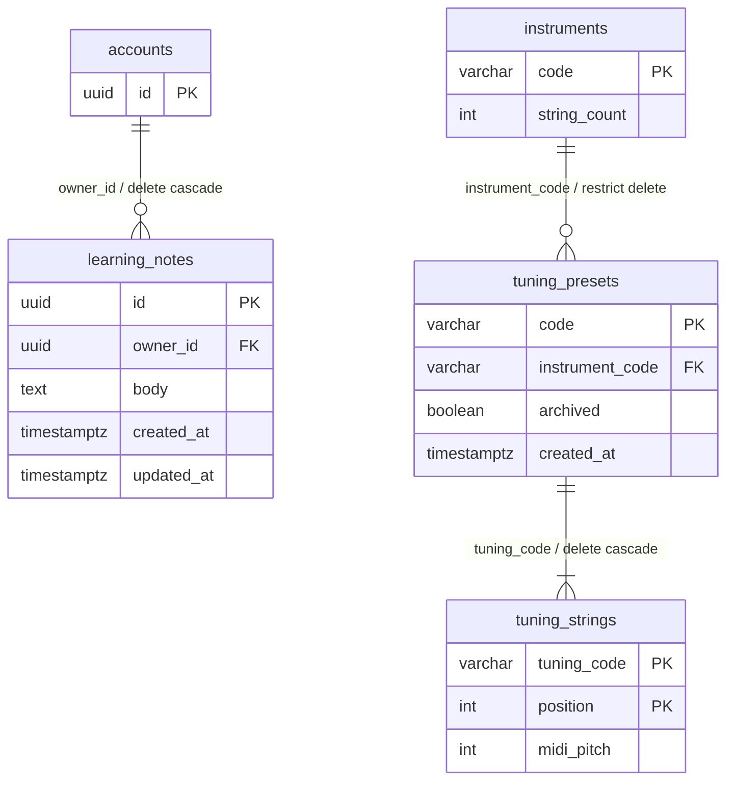

# Domain and data model — Phase 04

## Implemented boundaries

Catalog owns instrument/tuning reference definitions and a framework-independent immutable Tuning value object. Identity owns only an account UUID/timestamp anchor in this phase. Personal workspace owns immutable LearningNote validation and a repository protocol; SQL adapters implement owner-scoped reads/writes. Core model registration composes metadata for migrations and is infrastructure, not a shared domain layer. Domain imports are checked against framework/ORM imports. Runtime module rules remain tested as modules grow.

The private-note slice is deliberately small: it proves DAT ownership and deletion semantics on actual data before authentication and full workspace workflows. It has no route, public access or authentication shortcut. Phase 05 must derive actor IDs from authenticated sessions; arbitrary HTTP user_id must never be passed as the actor. Account UUIDs currently have no signup/login semantics. Phase 07 adds note application workflows and UI.

Tuning strings use declared instrument string order, not sorted frequency. Ukulele is re-entrant G4 C4 E4 A4. Pitches are MIDI integers (0–127); frequency is A4 reference × 2^((pitch−69)/12). Guitar order is string 6→1, bass 4→1, ukulele 4→1; persisted position 1 is the first member of that order, not a musician-facing string-number label. Domain validates instrument/count, finite positive reference and pitch types/range. SQL constrains independent ranges/FKs/uniqueness; cross-row tuning cardinality is validated by the domain when materializing, not guaranteed by a SQL trigger. Future admin writes must validate complete aggregate before persistence.

## Indexes, integrity and time

UUID account/note primary keys; natural instrument/tuning codes; composite tuning-code/position primary key prevents duplicate strings. Note owner FK is non-null and cascades with account. Index (owner_id, created_at) supports private listing by date; instrument-code index supports tuning filtering. Notes reject empty/oversized content in domain and database; updated_at is set by repository edits. Time columns use timezone-aware PostgreSQL timestamptz, representing absolute instants; local calendar display remains future UI work. Private note updates/deletes combine owner and ID predicates and return not-found for other owners.

## Planned entity and relationship map

| Phase | Owner | Entities and relationships | Integrity/lifecycle policy |
|---|---|---|---|
| 05 | identity | Account gains normalized email, credential hash, lifecycle status; Profile/Preferences one per account; Session, role assignments, verification/reset tokens reference account | Unique email; revoke tokens on deletion/password change; personal fields deleted, minimal staff audit anonymized |
| 07 | workspace | Task, Collection/Item, typed Song/Chord/Pattern favorites, linked Note | Owner FKs; unique owner-target and collection membership; validate ownership of nested/private links; delete with account |
| 08–11 | catalog/workspace | Existing reference tunings; Chord/Voicing/StringPosition, shared Pattern/Stroke, PrivateCustomChord/Pattern | Instrument-aware validation; private customs owner-only; archive referenced shared records |
| 12 | catalog | Song–Artist many-to-many, Alias, Arrangement–Section–ChordPlacement; TextVariant separate language/script; Source/RightsGrant/Attribution/Revision and staged imports | Distinct metadata/arrangement/text provenance; no unapproved publication; withdrawal/expiry hides affected content; archive stable references |
| 13–14 | practice | Session–ActiveInterval, Goal with effective dates, Routine–Item, Roadmap–Milestone–UserMilestone, Attempt/Summary | Owner/time indexes; nonnegative intervals; idempotent saves; recompute summaries on edits/deletes; per-user milestone uniqueness |
| 15–16 | content/practice | Report, AuditEvent, ReminderPreference | Reporter privacy and staff roles; timezone preferences; no permission prompts without user action |

No unused feature tables or lyrics are created now. The above is the detailed design baseline for later reviewed migrations. Shared catalogue rows never belong to a user just because the user favorited them. Private references cannot broaden access. No public sharing of custom items.

## Retention and deletion matrix

| Resource | Account deletion | Ordinary deletion | Shared references |
|---|---|---|---|
| Notes (implemented) | hard cascade | owner-scoped hard delete | no song links yet |
| Profile/preferences/sessions/tokens (planned) | remove/revoke | verified lifecycle actions | never retain credentials in audit |
| Tasks/customs/favorites/collections/practice/progress (planned) | remove private records and derived values | owner operation; recompute affected totals | do not delete shared catalogue targets |
| Shared catalogue (implemented tunings; other content planned) | unaffected | archive referenced records; FK restriction for instrument removal | cascading tuning-string removal only after explicit tuning deletion |
| Reports/audit (planned) | anonymize actor references/minimize payload | retention-controlled staff action | exact retention duration must be set before public release |

## Seed and migration strategy

0002_domain_foundation creates five tables; its downgrade removes them and all contained data and is only for reviewed disposable/development use. It does not import mutable ORM definitions or silently seed. Existing baseline 0001 remains unchanged. Autogeneration compares registered metadata and migration drift tests verify no changes needed after upgrade.

Run `python -m app.modules.catalog.seeds` from backend after migration with CHORD_DATABASE_URL configured. This transactionally inserts four instruments and eight tuning presets: standard/Drop D/DADGAD for acoustic and electric, standard bass, re-entrant ukulele. Source is the supplied SRS §4.3.2 and accepted tuning decisions, using mathematical equal temperament; these are original structured reference definitions, not copied song/lyrics content. Upserts do nothing on conflicts, preserve archive/editor changes and add missing rows without destructive replacement. Repeated runs are tested. No users, credentials, sample songs or private notes are seeded. Do not present this reference data as measured tuner accuracy.

## Acceptance and limitations

Tests exercise owner A/B reads/updates/deletes and mismatched-owner creation; valid own updates/deletes; invalid notes, missing owners, duplicate instruments/strings and invalid pitches; cascade and restrict behavior; preserved catalogue after account deletion; repeat seeds/archive handling; all preset pitches and re-entrant frequency order; migration clean upgrade/downgrade/drift; connection lifecycle. No claim of API authentication, completed account deletion workflow or user-visible note CRUD is made. Each future private resource must add equivalent isolation tests, not inherit completion from notes.
